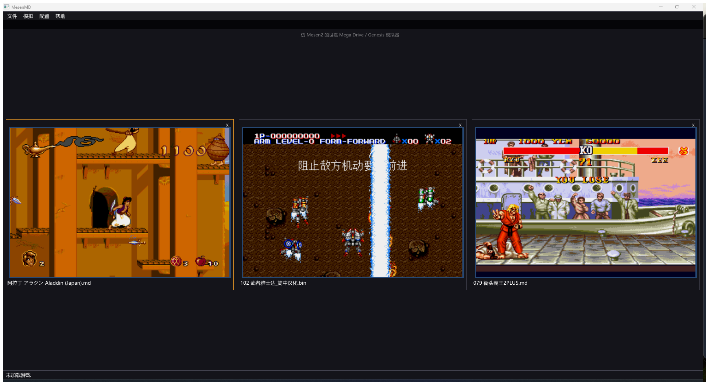
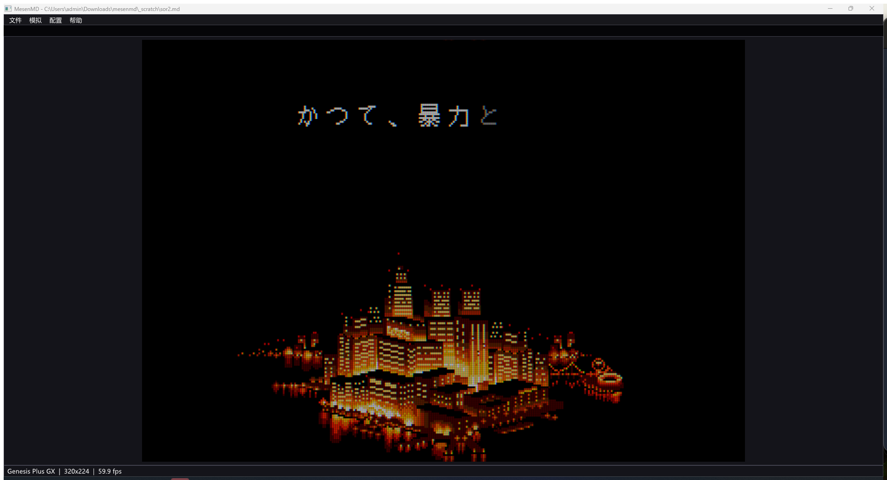
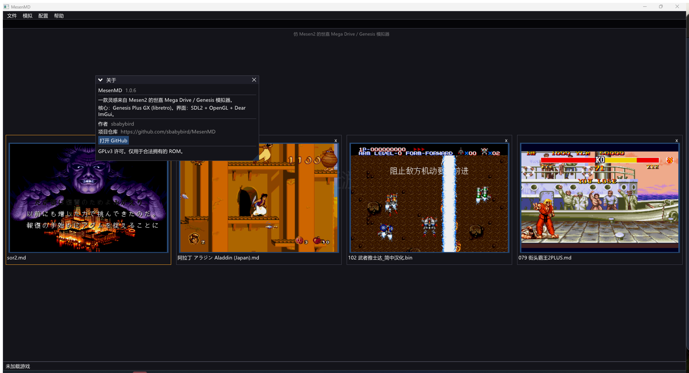

# MesenMD

一个行为与外观都尽量贴近 **Mesen2** 的 **Sega Mega Drive / Genesis** 模拟器前端。

> English: [README_EN.md](README_EN.md)

**当前版本：v1.0.16**  ·  Windows (MinGW-w64)  ·  作者：[sbabybird](https://github.com/sbabybird)

- **核心**：[Genesis Plus GX (libretro)](https://github.com/libretro/Genesis-Plus-GX) —— RetroArch 的官方 MD 核心，精度高，支持 MD / Sega CD / Master System / Game Gear。
- **前端界面**：SDL2 + OpenGL 3 + Dear ImGui，深色主题，行为与外观尽量贴近 Mesen2。
- **平台**：Windows（MinGW-w64 编译）。
- **仓库**：<https://github.com/sbabybird/MesenMD>

> 仅供学习与测试，请使用你合法拥有的 ROM / BIOS 文件。

---

## 截图

### 主页



### 游戏画面



### 关于



---

## 特性

- [x] 加载 Mega Drive / Genesis ROM（命令行参数或 `文件 -> 打开 ROM...`）
- [x] 「最近打开」历史记录，首页以截图卡片展示
- [x] 视频缩放：适配窗口 / 原始 / 整数倍（x2–x5）
- [x] 双线性过滤开关
- [x] 帧率显示 FPS
- [x] 音频输出（SDL2 队列驱动，接近实时节奏）
- [x] 键盘按键重映射（`配置 -> 输入...`，每个动作可绑定多个键）
- [x] 手柄支持（SDL_GameController，玩家 1 / 玩家 2，支持 XInput / DirectInput）
- [x] 手柄快捷键（可重映射）
- [x] 暂停 / 复位 / 关闭游戏
- [x] 支持中文等非 ASCII 路径（UTF-8 处理）
- [x] 拖放 ROM 文件到窗口即可加载
- [x] 界面多语言：English / 中文（默认跟随系统语言，可在 `配置 -> 语言` 切换）
- [x] 全屏切换（F11）
- [x] 视频滤镜：LCD Grid / CRT / Scanlines（官方 RetroArch GLSL shader）
- [x] 自动保存 / 自动加载游戏状态（关闭 / 打开游戏时）
- [x] 首页：去掉标题与滚动条，截图自动缩放并居中，背景水印 + 产品标语
- [x] 关于对话框：作者信息 + 一键打开 GitHub 仓库
- [x] 界面主题：亮色 / 暗色 / 跟随系统

---

## 目录结构

```
mesenmd/
├── src/
│   ├── main.cpp        # SDL2 + OpenGL + ImGui 前端
│   ├── emulator.h      # libretro 核心封装头
│   └── emulator.cpp    # 核心动态加载 + 视频/音频/输入/环境回调
├── third_party/
│   ├── SDL2-2.32.10/                # SDL2 MinGW 开发包
│   ├── imgui-master/                # Dear ImGui
│   └── Genesis-Plus-GX-master/      # 核心源码（含已编译 DLL）
├── build.cmd           # 一键编译前端 + 复制运行时依赖
├── MesenMD.exe         # 编译产物
├── SDL2.dll            # 运行时依赖
└── genesis_plus_gx_libretro.dll     # 核心运行时
```

---

## 依赖

- **MinGW-w64 GCC**（示例：`D:\ThirdLib\mingw64\bin`，gcc 13.x）
- **SDL2 2.32.x** MinGW 开发包（`third_party\SDL2-2.32.10`）
- **Dear ImGui**（`third_party\imgui-master`）
- **Genesis Plus GX** 源码（`third_party\Genesis-Plus-GX-master`）

---

## 编译

### 1. 编译核心（Genesis Plus GX）

本仓库已附带编译好的 `genesis_plus_gx_libretro.dll`。若要重新编译：

```bat
cd third_party\Genesis-Plus-GX-master
:: 先创建 uname 垫片（MinGW 在 Windows 下 make 会找不到 uname）
:: 文件 build_tools\uname.cmd 内容：  @echo MINGW64_NT-10.0
set PATH=%CD%\build_tools;%PATH%
mingw32-make -f Makefile.libretro platform=win CC=gcc CXX=g++
```

产物为 `genesis_plus_gx_libretro.dll`。

### 2. 编译前端

方式 A —— 双击运行 `build.cmd`：

```bat
build.cmd
```

方式 B —— 手动 g++（在项目根目录）：

```bat
g++ -std=c++17 -O2 -mwindows -Isrc ^
  -Ithird_party\imgui-master -Ithird_party\imgui-master\backends ^
  -Ithird_party\SDL2-2.32.10\x86_64-w64-mingw32\include\SDL2 ^
  -Ithird_party\Genesis-Plus-GX-master\libretro\libretro-common\include ^
  src\main.cpp src\emulator.cpp ^
  third_party\imgui-master\imgui.cpp third_party\imgui-master\imgui_draw.cpp ^
  third_party\imgui-master\imgui_tables.cpp third_party\imgui-master\imgui_widgets.cpp ^
  third_party\imgui-master\backends\imgui_impl_sdl2.cpp ^
  third_party\imgui-master\backends\imgui_impl_opengl3.cpp ^
  -Lthird_party\SDL2-2.32.10\x86_64-w64-mingw32\lib ^
  -lmingw32 -lSDL2main -lSDL2 -lshell32 -lopengl32 -lgdi32 -lwinmm -lcomdlg32 ^
  -static-libgcc -static-libstdc++ -o MesenMD.exe
```

复制运行时依赖到 exe 同目录（`build.cmd` 已自动完成）：

```bat
copy third_party\SDL2-2.32.10\x86_64-w64-mingw32\bin\SDL2.dll .
copy third_party\Genesis-Plus-GX-master\genesis_plus_gx_libretro.dll .
```

---

## 运行

双击 `MesenMD.exe`，或传入 ROM 路径：

```bat
MesenMD.exe "C:\path\to\game.md"
```

也可在界面中 `文件 -> 打开 ROM...`（Ctrl+O）选择 `.md / .bin / .gen / .smd / .sg / .68k`。

---

## 默认按键

| 动作 | 键盘 |
|------|------|
| 方向 | 方向键 / W A S D |
| A / B / C | X / Z / C 或 J / K / L |
| X / Y / Z | U / I / O |
| Start | Enter / 小键盘 Enter / B |
| Mode | Right Shift / Left Shift / V |
| 重置 | F12 |
| 暂停 / 继续 | Space |
| 打开 ROM | Ctrl+O |
| 关闭游戏 | Ctrl+W |

---

## 快捷键

| 快捷键 | 功能 |
|------|------|
| Esc | 关闭当前对话框；游戏中则关闭游戏（自动保存状态与快照） |
| Ctrl+C | 退出程序（自动保存状态与快照） |
| F11 | 切换全屏（桌面全屏） |
| F1 - F10 | 快速加载状态槽 1-10 |
| Shift+F1 - F10 | 快速保存状态槽 1-10 |
| F12 | 重置游戏 |
| Space | 暂停 / 继续 |
| Ctrl+O | 打开 ROM |
| Ctrl+W | 关闭游戏 |

---

## 手柄快捷键

**Select** 指手柄的 Back / Select 键。默认组合（可在 `配置 -> 输入...` 的「手柄快捷键」区重映射）：

| 动作 | 默认组合 |
|------|------|
| 保存状态 | Select + 右肩键（RB） |
| 加载状态 | Select + 左肩键（LB） |
| 退出游戏 | Select + Start |
| 重置游戏 | L3 + R3（同时按下左右摇杆） |
| 退出程序 | Select + Y |
| 暂停 | Select + A |
| 全屏 | Select + B |

重映射方法：在「手柄快捷键」区点击「重新绑定」，先按住修饰键再按目标按钮；按 `Esc` 取消。

---

## 输入设置

在 `配置 -> 输入...` 中提供了三个标签页（参考 Mesen2 的交互方式）：

- **键盘**：每个动作可绑定多个按键（方向键与 WASD 可同时用于移动）；点击某个绑定可添加 / 删除 / 重绑，按 `Esc` 取消，点 `x` 删除，`+ 添加` 新增，`全部重置` 恢复默认。
- **手柄**：选择已连接设备并分配给玩家 1 / 玩家 2，逐个动作重映射。面板提供「当前输入」实时读数与「输入诊断」，能清楚看到正在按下的按钮 / 摇杆 / 方向键编号，方便映射陌生的 DirectInput 手柄。
- **快捷键**：重映射手柄快捷组合（修饰键 + 按钮），支持保存 / 加载状态、重置、退出游戏、退出程序、暂停与全屏。

手柄说明：

- XInput 与已知的 DirectInput 手柄通过 SDL 自带的 `SDL_GameController` 数据库自动映射。未知 / 裸 DirectInput 摇杆也会被打开为通用摇杆，并给出合理默认（面板按键 `0-5` = A/B/C/X/Y/Z，无方向帽与摇杆时自动检测按键式方向键）。
- 手柄支持热插拔，每个设备可分配给玩家 1 或 玩家 2；按 GUID 将映射持久化到 `mesenmd.cfg`。
- 键盘与所有已连接手柄会叠加共同驱动玩家，多个手柄或手柄 + 键盘可同时操作同一玩家。
- 可自定义映射：将 `gamecontrollerdb.txt` 放到 `MesenMD.exe` 同目录即可。
- 默认 6 键手柄映射（标准 SDL / Xbox 布局）：`X` = MD A，`A` = MD B，`B` = MD C，`LB` = MD X，`Y` = MD Y，`RB` = MD Z，`Start` = Start，`Back / Guide` = Mode。

---

## 兼容性与说明

- 核心通过 `LoadLibrary` 动态加载 `genesis_plus_gx_libretro.dll`，该 DLL 需与 `MesenMD.exe` 同目录。
- ROM 路径按 UTF-8 传递，核心会自行打开文件（`need_fullpath`），因此支持中文路径。
- 若运行 Sega CD / 32X 等需要扩展 BIOS 的游戏，请将对应 BIOS 放到 ROM 所在目录，或稍后可在 `配置` 中增加系统目录设置。
- 本项目为个人学习项目，无官方支援；界面细节仍在逐步完善。

---

## 许可

- Genesis Plus GX：GPLv3。
- Dear ImGui：MIT。
- SDL2：zlib。
- 本项目前端代码：随核心以 GPLv3 发布。

请仅使用你合法拥有的游戏 ROM / BIOS。

