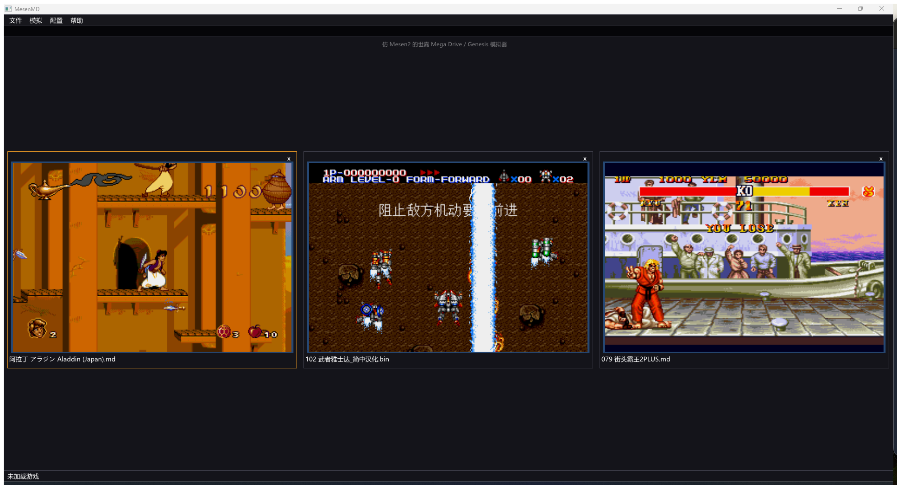
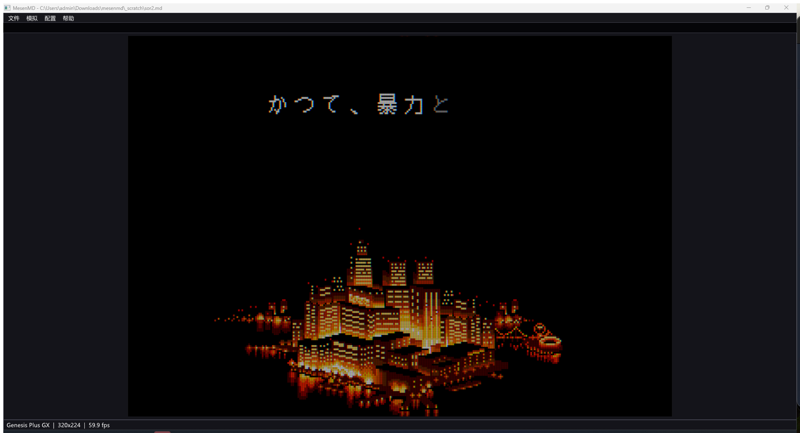
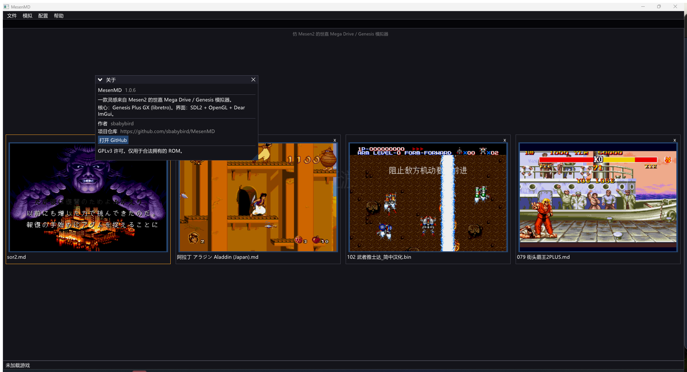

# MesenMD

A Sega Mega Drive / Genesis emulator front-end whose look and behavior are modeled on **Mesen2**.

> 中文版：看 [README.md](README.md)

**Current version: v1.0.10**  ·  Windows (MinGW-w64)  ·  Author: [sbabybird](https://github.com/sbabybird)

- **Core**: [Genesis Plus GX (libretro)](https://github.com/libretro/Genesis-Plus-GX) — the official MD core used by RetroArch; high accuracy, supports MD / Sega CD / Master System / Game Gear.
- **Front-end**: SDL2 + OpenGL 3 + Dear ImGui, dark theme, behavior and appearance as close to Mesen2 as possible.
- **Platform**: Windows (MinGW-w64 build).
- **Repository**: <https://github.com/sbabybird/MesenMD>

> For learning and testing only. Please use ROM / BIOS files that you legally own.

---

## Screenshots

### Home



### In-game



### About



---

## Features

- [x] Load Mega Drive / Genesis ROM (command line or `File -> Open ROM...`)
- [x] Recent-games history, shown as snapshot cards on the home page
- [x] Video scaling: fit window / native / integer (x2–x5)
- [x] Bilinear filter toggle
- [x] On-screen FPS counter
- [x] Audio output (SDL2 queue-driven, near real-time)
- [x] Keyboard remapping (`Config -> Input...`, multiple keys per action)
- [x] Gamepad support (SDL_GameController, Player 1 / Player 2, XInput / DirectInput)
- [x] Gamepad hotkeys (rebindable)
- [x] Pause / Reset / Close game
- [x] Non-ASCII paths (e.g. Chinese) handled as UTF-8
- [x] Drag-and-drop a ROM file onto the window to load it
- [x] UI localization: English / Chinese (defaults to the system language; switchable under `Config -> Language`)
- [x] Fullscreen toggle (F11)
- [x] Video filters: LCD Grid / CRT / Scanlines (official RetroArch GLSL shaders)
- [x] Auto-save / auto-load game state on close / open
- [x] Home page: no title or scrollbar, thumbnails auto-fit and center, faint watermark + product tagline
- [x] About dialog: author info + Open GitHub button
- [x] UI themes: Light / Dark / follow system

---

## Directory Layout

```
mesenmd/
├── src/
│   ├── main.cpp        # SDL2 + OpenGL + ImGui front-end
│   ├── emulator.h      # libretro core wrapper header
│   └── emulator.cpp    # core dynamic loading + video/audio/input/env callbacks
├── third_party/
│   ├── SDL2-2.32.10/                # SDL2 MinGW dev package
│   ├── imgui-master/                # Dear ImGui
│   └── Genesis-Plus-GX-master/      # core source (includes prebuilt DLL)
├── build.cmd           # one-click front-end build + copy runtime deps
├── MesenMD.exe         # build output
├── SDL2.dll            # runtime dependency
└── genesis_plus_gx_libretro.dll     # core runtime
```

---

## Dependencies

- **MinGW-w64 GCC** (e.g. `D:\ThirdLib\mingw64\bin`, gcc 13.x)
- **SDL2 2.32.x** MinGW dev package (`third_party\SDL2-2.32.10`)
- **Dear ImGui** (`third_party\imgui-master`)
- **Genesis Plus GX** source (`third_party\Genesis-Plus-GX-master`)

---

## Building

### 1. Build the core (Genesis Plus GX)

The repo ships a prebuilt `genesis_plus_gx_libretro.dll`. To rebuild it:

```bat
cd third_party\Genesis-Plus-GX-master
:: Create an uname shim first (MinGW make cannot find uname on Windows)
:: build_tools\uname.cmd content:  @echo MINGW64_NT-10.0
set PATH=%CD%\build_tools;%PATH%
mingw32-make -f Makefile.libretro platform=win CC=gcc CXX=g++
```

Output: `genesis_plus_gx_libretro.dll`.

### 2. Build the front-end

Option A — double-click `build.cmd`:

```bat
build.cmd
```

Option B — manual g++ (from the project root):

```bat
g++ -std=c++17 -O2 -mwindows -Isrc ^
  -Ithird_party\imgui-master -Ithird_party\imgui-master\backends ^
  -Ithird_party\SDL2-2.32.10\x86_64-w64-mingw32\include\SDL2 ^
  -Ithird_party\Genesis-Plus-GX-master\libretro\libretro-common\include ^
  src\main.cpp src\emulator.cpp ^
  third_party\imgui-master\imgui.cpp third_party\imgui-master\imgui_draw.cpp ^
  third_party\imgui-master\imgui_tables.cpp third_party\imgui-master\imgui_widgets.cpp ^
  third_party\imgui-master\backends\imgui_impl_sdl2.cpp ^
  third_party\imgui-master\backends\imgui_impl_opengl3.cpp ^
  -Lthird_party\SDL2-2.32.10\x86_64-w64-mingw32\lib ^
  -lmingw32 -lSDL2main -lSDL2 -lshell32 -lopengl32 -lgdi32 -lwinmm -lcomdlg32 ^
  -static-libgcc -static-libstdc++ -o MesenMD.exe
```

Copy runtime dependencies next to the exe (already done by `build.cmd`):

```bat
copy third_party\SDL2-2.32.10\x86_64-w64-mingw32\bin\SDL2.dll .
copy third_party\Genesis-Plus-GX-master\genesis_plus_gx_libretro.dll .
```

---

## Running

Double-click `MesenMD.exe`, or pass a ROM path:

```bat
MesenMD.exe "C:\path\to\game.md"
```

You can also use `File -> Open ROM...` (Ctrl+O) to pick `.md / .bin / .gen / .smd / .sg / .68k`.

---

## Default Keyboard

| Action | Keys |
|------|------|
| D-pad | Arrows / W A S D |
| A / B / C | X / Z / C or J / K / L |
| X / Y / Z | U / I / O |
| Start | Enter / Numpad Enter / B |
| Mode | Right Shift / Left Shift / V |
| Reset | F12 |
| Pause / Resume | Space |
| Open ROM | Ctrl+O |
| Close Game | Ctrl+W |

---

## Shortcuts

| Shortcut | Function |
|------|------|
| Esc | Close the current dialog; in-game it closes the game (auto-saves state and snapshot) |
| Ctrl+C | Quit the program (auto-saves state and snapshot) |
| F11 | Toggle fullscreen (desktop fullscreen) |
| F1 - F10 | Quick-load state slot 1-10 |
| Shift+F1 - F10 | Quick-save state slot 1-10 |
| F12 | Reset game |
| Space | Pause / Resume |
| Ctrl+O | Open ROM |
| Ctrl+W | Close game |

---

## Gamepad Hotkeys

**Select** refers to the controller's Back / Select button. Default combinations (rebindable in `Config -> Input...` → Hotkeys):

| Action | Default |
|------|------|
| Save State | Select + Right Shoulder (RB) |
| Load State | Select + Left Shoulder (LB) |
| Exit Game | Select + Start |
| Reset | L3 + R3 (press both sticks) |
| Quit Program | Select + Y |
| Pause | Select + A |
| Fullscreen | Select + B |

To rebind: in the Hotkeys tab, click Rebind, hold the modifier first, then press the target button; press `Esc` to cancel.

---

## Input Settings

`Config -> Input...` provides three tabs (in the spirit of Mesen2):

- **Keyboard**: bind several keys per action (arrow keys and WASD can both move); click a binding to add / remove / rebind, press `Esc` to cancel, `x` to delete, `+ Add` to add a key, `Reset All` to restore defaults.
- **Gamepads**: pick the connected device, assign it to Player 1 / Player 2, and rebind each action. A live **Active input** readout plus an **Input diagnostics** panel show exactly which physical button / stick / D-pad is pressed, so an unfamiliar DirectInput pad is easy to map.
- **Hotkeys**: rebind controller shortcut combos (modifier + button) for save/load state, reset, exit game, quit program, pause and fullscreen.

Gamepad notes:

- XInput and known DirectInput pads auto-map through SDL's built-in `SDL_GameController` database. Unknown / raw DirectInput pads are opened as generic joysticks so they still work, with a sensible default (face buttons `0-5` = A/B/C/X/Y/Z and a button-based D-pad detected when there is no hat or stick).
- Pads are hot-plugged and each can be assigned to Player 1 or Player 2; per-device mappings are persisted in `mesenmd.cfg` by GUID.
- Keyboard and all connected pads combine, so multiple pads or a pad plus the keyboard can drive the same player at the same time.
- Optional custom mappings can be added by placing a `gamecontrollerdb.txt` next to `MesenMD.exe`.
- Default 6-button gamepad mapping (standard SDL/Xbox layout): `X` = MD A, `A` = MD B, `B` = MD C, `LB` = MD X, `Y` = MD Y, `RB` = MD Z, `Start` = Start, `Back/Guide` = Mode.

---

## Compatibility & Notes

- The core is loaded dynamically via `LoadLibrary` from `genesis_plus_gx_libretro.dll`, which must be in the same directory as `MesenMD.exe`.
- ROM paths are passed as UTF-8 and the core opens the file itself (`need_fullpath`), so non-ASCII (e.g. Chinese) paths work.
- For Sega CD / 32X games that require extra BIOS files, place the relevant BIOS in the ROM directory; a system-directory setting may be added later in `Config`.
- This is a personal learning project with no official support; UI details are still evolving.

---

## License

- Genesis Plus GX: GPLv3.
- Dear ImGui: MIT.
- SDL2: zlib.
- This project's front-end code: released under GPLv3 along with the core.

Please only use game ROM / BIOS files you legally own.

